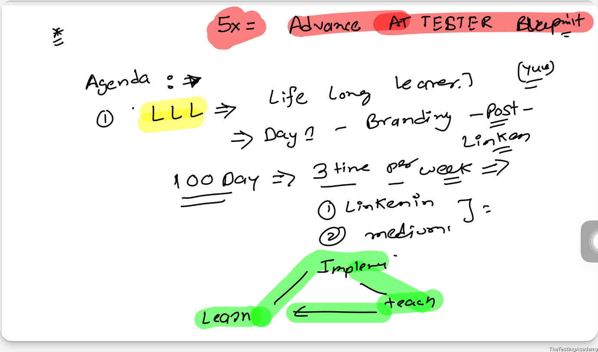
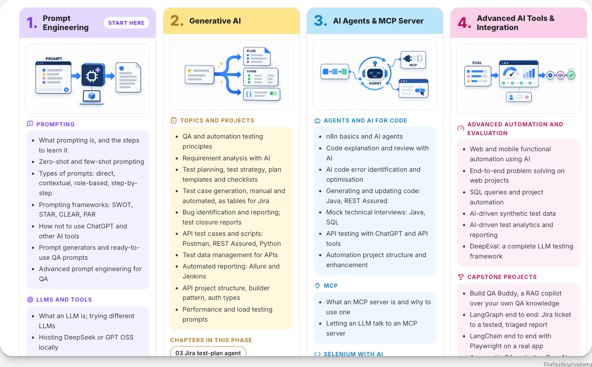
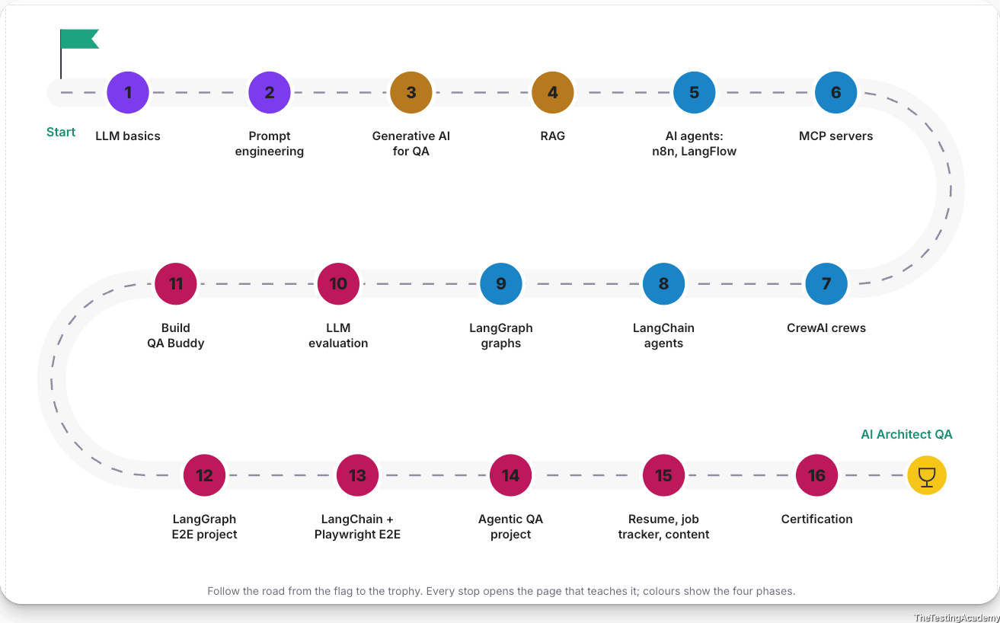

5X Advanced AI Tester Blueprint

## Agenda
- <u>LLL -> Life Long LEANER</u>
- <u>Action Plan for the 12+ Weeks</u>
- How to access the courses ? (Recordings)
- How to Ask the Doubts, Get the Task and Discuss my problem?
- Sequence to follow.
- Required Access SDETCLUB.com
- No Knowledge for Playwright / Selenium is required for this.
- **Laptop Configuration**
    - **Personal  - (8-16) GB RAM, 256 GB SSD/HDD - Yes**
    - Office Laptop Issues Configuration - Not Recommend

- Local LLM Setup
- Cloud AI - Groq Setup
- IDE Setup
    - VS Code with github co pilot
    - Antigravity
    - Cursor / Windsurf

- Github Account Setup
- LangFlow & n8n Setup

Skill Creation -> QASkills.sh -> L0

**<u>Roadmap - Action Plan for the 12+ Weeks</u>**

[app.thetestingacademy.com/ai/#roadmap](https://app.thetestingacademy.com/ai/#roadmap) 

# Sequence to follow
1. Skill Basics
2. LLM Basics
3. Prompt Eng
4. Generative AI
    1. Github Copilot
    2. Claude Code
    3. Command Code/ OpenCode AI

5. AI Agents (RAG)
    1. Vibe Code
    2. n8n
    3. **Langflow**
    4. Crew AI / LangChain(Python Basics)
    5. LangGraph - AI Agents(Multi Agents) QA

6. RAG 
    1. 10 + TYPES 
    2. Langlfow
    3. n8n
    4. Vibe Code
    5. **2 Production Ready RAG  - QABuddyAI**

7. **MCP**
    1. Use
    2. Create Own MCP - FastMCP
    3. Debug MCP
    4. **Automation + AI** 
    5. 1 Prod READY MCP( company)

8. **<u>Python Basics + PyTest</u>** 
9. **<u>LLM Eval</u>**
    1. Basic LLM Eval
    2. **DeepEval**
        1. **Basics**
        2. **Framework**
            1. **ChatBot, AI Agents, RAG**

    3. PromptFoo
    4. OpenEvAL, RAGAs

10. AI Agents via
    1. LangChain (Multi agents) ( agentic QA)
    2. Production Ready Agentic QA Projects - **LangGraph.**

11. AI Testing tools
    1. 3-4 AI Testing
        1. [browserbash.com/](https://browserbash.com/) 
        2. [qabattle.com/](https://qabattle.com/) 
        3. [qaskills.sh/](https://qaskills.sh/) 
        4. Selenium To Playwright
        5. **Snaplocator**
        6. 41+ [app.thetestingacademy.com/ai/blueprint/hackathon](https://app.thetestingacademy.com/ai/blueprint/hackathon) 

12. Deployment +(VPS, Cloud) CI/CD + Automation via AI. 
13. Projects - 
    1. 35+ AI Projects( AI Agents, MCP, RAG, LLM EvaL)+ AI Testing Tool).

**Bonus Course**

1. Claude 101 -> [courses.thetestingacademy.com/courses/claude-101/dashboard](https://courses.thetestingacademy.com/courses/claude-101/dashboard) 
2. GitHub Co-Pilot for QA -> [courses.thetestingacademy.com/courses/github-co-pilot-for-qa/dashboard](https://courses.thetestingacademy.com/courses/github-co-pilot-for-qa/dashboard) 
3. E2E Testing ChatBot, AI Agent, RAG, MCP Server with DeepEval Framework -> [courses.thetestingacademy.com/courses/e2e-testing-chatbot-ai-agent-rag-mcp-server-with-deepeval-framework/dashboard](https://courses.thetestingacademy.com/courses/e2e-testing-chatbot-ai-agent-rag-mcp-server-with-deepeval-framework/dashboard) 
4. Build Agentic AI & Multi-Agent System for Software Testing (Crew AI, LangChain)
    1. [courses.thetestingacademy.com/courses/build-agentic-ai-multi-agent-system-for-software-testing-crew-ai-langchain/dashboard](https://courses.thetestingacademy.com/courses/build-agentic-ai-multi-agent-system-for-software-testing-crew-ai-langchain/dashboard) 

5. AI Automation with n8n
    1. [courses.thetestingacademy.com/courses/ai-automation-with-n8n/dashboard](https://courses.thetestingacademy.com/courses/ai-automation-with-n8n/dashboard) 

## MARK DOWN File (.md)

-  It is a plain, normal text-based language with formatting
[stackedit.io/app](https://stackedit.io/app) 

Ex:  File.md
[code.visualstudio.com/download?_exp_download=d53503e735](https://code.visualstudio.com/download?_exp_download=d53503e735) 

## Push the code with the skillcreated - advance.
[github.com/PramodDutta/AITesterBlueprint5x/blob/main/Chapter_00_SKILL_Basics/01_advance-skills/testplan-creator-skill_a/SKILL.md](https://github.com/PramodDutta/AITesterBlueprint5x/blob/main/Chapter_00_SKILL_Basics/01_advance-skills/testplan-creator-skill_a/SKILL.md) 

**Task for 3** 

[github.com/PramodDutta/skillmasterclass/tree/main/skillmasterclass/skills](https://github.com/PramodDutta/skillmasterclass/tree/main/skillmasterclass/skills) 

===========================================================================

# AI Engineering
Building applications on the top of existing foundation models

