## Notes link 
https://app.eraser.io/workspace/4T1SjnqdXzNr0lmUBdEC

## **What Changed After 2020 –> The Era of Scale**
Before 2020, AI models were like **smart calculators** – good at one thing. After 2020, AI models became like **super interns** – they can write, read, code, explain, summarize, and even reason.

### **AI after 2020 is defined by scale.**
- Models like ChatGPT, Gemini, Midjourney are extremely large
- They consume massive compute, electricity, and data
- Public internet data is becoming a limiting factor.


### **Two Major Consequences of Scale**


1. **Capability Explosion**
    - Models can now perform many tasks well
    - New applications became possible (coding, writing, planning, vision)

2. **Model-as-a-Service Emergence**
    - Training large models is expensive and centralized
    - A few organizations build models
    - Everyone else consumes them via APIs

➡️ Result: **AI application demand increased while entry barriers dropped**

## **What Is AI Engineering?**
**AI Engineering** = Building applications **on top of existing foundation models**.

Using powerful pre-built AI brains to solve real problems == **AI Engineering.**

_You are not training the brain(Foundation Model) aks Large Language Model  from scratch._ 

_You are:_

- Giving it instructions
- Giving it context
- Checking its answers
- Connecting it to real systems

### **Why AI Engineering Is Growing Fast**
- Powerful models already exist
- APIs make usage simple
- Minimal infrastructure required
- Even non-engineers can build AI apps

AI Engineering is now one of the **fastest-growing engineering disciplines**.

1. Basics AI
2. Prompting
3. GHCP, Curosr, Windsurf... other Claude. (10%) 

# Sequence to follow
1. LLM Basics or AI Foundations
2. Prompt Eng
3. Generative AI
4. AI Agents 
    1. Vibe Code
    2. n8n
    3. Langflow
    4. **Crew AI /LangChain(Python Basics)**

5. RAG 
    1. 10 + TYPES 
    2. Langlfow
    3. n8n
    4. Vibe Code

6. MCP
    1. Use
    2. Create Own MCP

7. Python Basics & PyTest
8. LLM Eval
    1. **DeepEval**
    2. PromptFoo

9. AI Testing tools
    1. 3-4 AI Testing

10. Projects - 
    1. 28+ AI Projects( AI Agents, MCP, RAG, LLM EvaL)+. AI Testing Tool).

11. Python -> LangChain and **LangGraph ( QA Pipelines projects)**
12. Certifications.


**AI Coding Agent. | Coding Tools. | Agentic Coding Tools**

- Cursor -> Brain ( composer 2.5, Chatp 4.7 Opus)
- Windsurf
- Claude Code
- **Codex**
- KIRO IDE
- OpenCode
- Command Code
- Antrigravity
- Github Copilot.

**ChatBots** 

1. ChatGPT
2. Claude.ai
3. Chat.deepseek.com
4. MS Copilot
---

1. LLM Types
2. Token
3. Local LLM - Ollama, LM Studio


**LLM**

1. **Open Source (Weights Public)** 
    1. Deepseek
    2. Mistral
    3. Kimi K3
    4. Qwen
    5. GLM

2. **Closed Source (They will not share the information)**
    1. Grok
    2. Claude
        1. opus 
        2. fable
        3. mythos

    3. GPT
    4. Gemini


Ollama

Application which can help to you run the LLM on the Local as well as the Cloud.


[huggingface.co/models](https://huggingface.co/models) 

[huggingface.co/models?sort=trending](https://huggingface.co/models?sort=trending) 


**Ollama , There** alternate  **-> LM Studio, Llama.cpp**

These are the applications which can run the **open source model on your machines**. So your machine configuration is very important if you want to run a local LLM on your system 


 **Local LLM is nothing but an open source model which will run on your system.**

 **I want to run a local LLM on my system, my Windows machine, or my Mac machine** 

-  you will need a higher RAM, everyone. **If you have a lower RAM, less than 8GB**, it will not run 
-  please remember, local LLMs are very slow 
- when you run **local LLM into your system**, your computer **will hang, probably switch off also after some time, because the processing power will take a lot of energy** 


**Disclaimer :** 

-  if you are using your personal laptop, type P in the channel 
-  you are using your Office laptop type O in the chat - [don't install ollama or anyother Local app untill you have permission)


Ollama Downalod or LM Studio

1. [ollama.com/download](https://ollama.com/download) 
2. [lmstudio.ai/download](https://lmstudio.ai/download) 

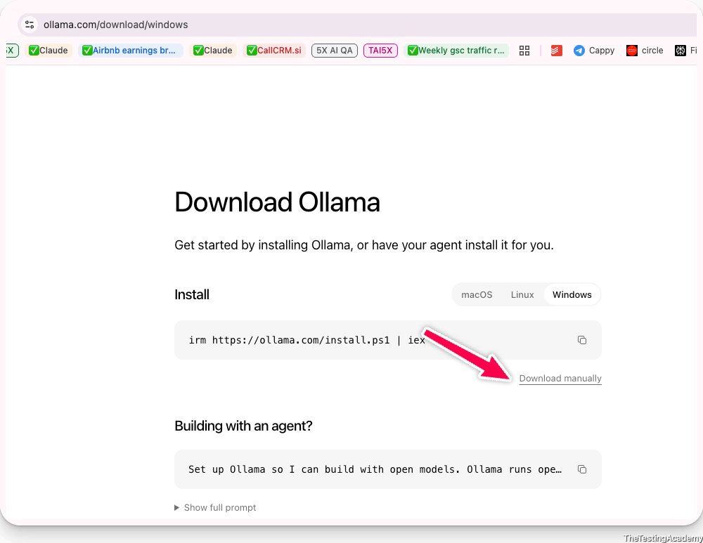

Please remember, most of the companies nowadays, I don't know if your company has allowed the use of Ollama or LM Studio or not, so it is better you should ask for permission.

64 GB RAM -> 8B parameter

32GB RAM -> 4B parameter Model

16 GB ram -> 3B

8GB ram -> **1B**, 2B ,3B(hang a alot)

4GB ram -> that my friend you need to buy a new laptop :)


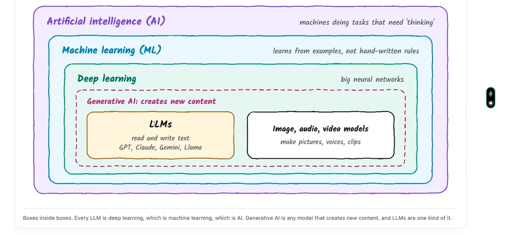

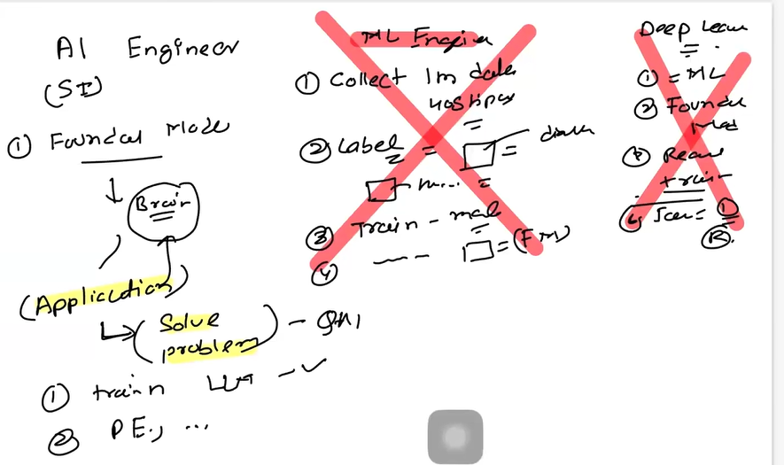

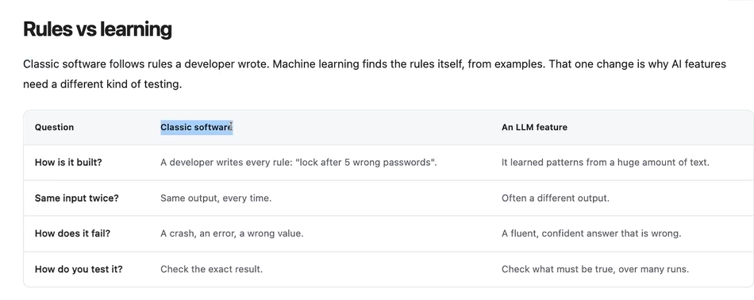

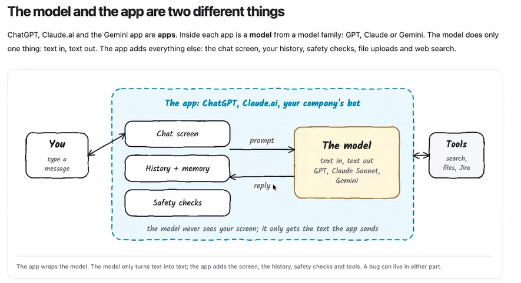

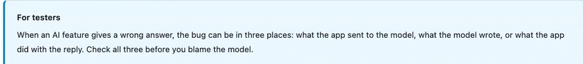

New Model of application

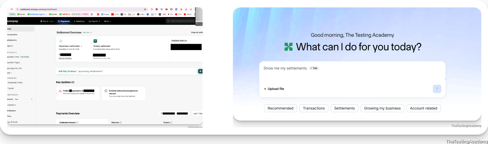

**AI Coding Agent. | Coding Tools. | Agentic Coding Tools**

- Cursor -> Brain ( composer 2.5, Chatp 4.7 Opus)
- Windsurf
- Claude Code
- **Codex**
- KIRO IDE
- OpenCode
- Command Code
- Antrigravity
- Github Copilot.


**ChatBots** 

1. ChatGPT
2. Claude.ai
3. Chat.deepseek.com
4. MS Copilot


## What an LLM is not

Not a search engine. It does not look anything up, unless the app gives it a search tool.
Not a database. There is no table of facts inside; its knowledge is spread across billions of learned numbers.
Not a calculator. It predicts text, so it can get maths wrong.
Not up to date. It knows nothing after its training ended, and nothing about your private product unless the app gives it the text.

## Think of it like a brilliant intern

An LLM is like a very well-read intern: fast, fluent and confident. But it cannot check its own facts unless you give it a way to check: the source document, a book, a test.

```
REMEMBER

AI contains machine learning, which contains deep learning, which contains LLMs. Generative AI is any AI that creates new content.
The model only turns text into text. The app around it does the rest.
Test the whole path: what was sent, what came back, and what the app did with it.
```

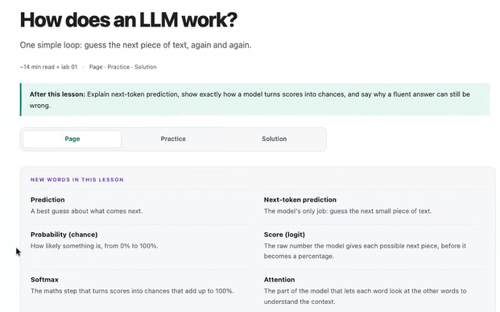

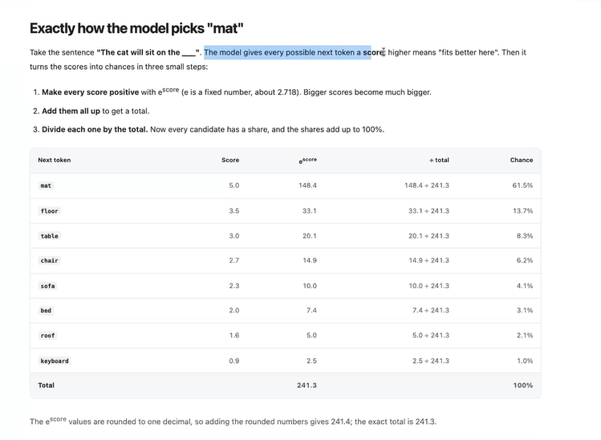

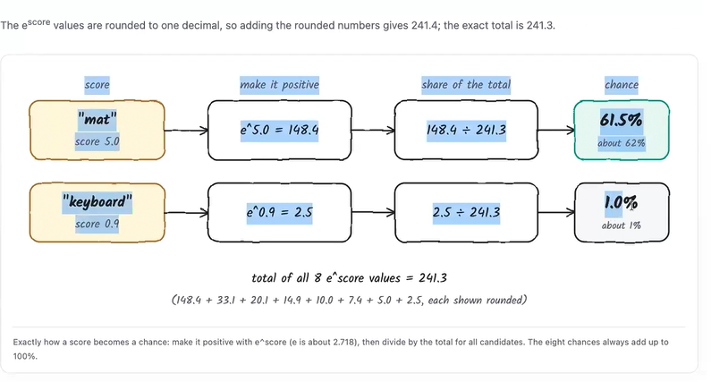

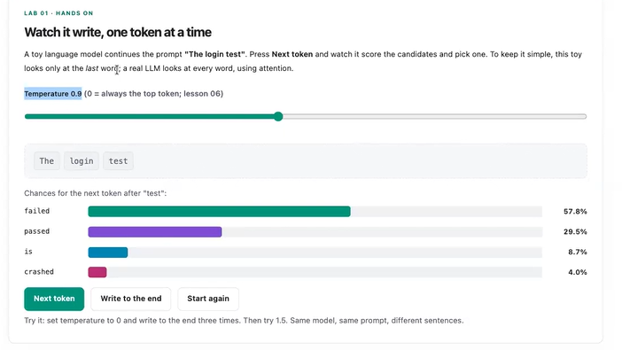


## Temparature in LLM
Temperature is a setting that controls how random or creative an LLM's responses are when choosing the next token (word or word-piece).

Think of it as a creativity dial:


| Temperature | Behavior | Example Use Case |
|-------------|----------|------------------|
| 0.0 | Very deterministic, almost always picks the highest-probability token | Code generation, APIs, test cases |
| 0.2 - 0.5 | Mostly consistent with slight variation | Technical documentation, summaries |
| 0.7 - 1.0 | Balanced creativity and accuracy | General chat, content writing |
| 1.2+ | Highly creative and unpredictable | Brainstorming, storytelling |

==========================================================
1. LLM Types
2. Token
3. Local LLM - Ollama, LM Studio


**LLM**

1. **Open Source (Weights Public)** 
    1. Deepseek
    2. Mistral
    3. Kimi K3
    4. Qwen
    5. GLM

2. **Closed Source (They will not share the information)**
    1. Grok
    2. Claude
        1. opus 
        2. fable
        3. mythos

    3. GPT
    4. Gemini


Ollama

Application which can help to you run the LLM on the Local as well as the Cloud.


[huggingface.co/models](https://huggingface.co/models) 

[huggingface.co/models?sort=trending](https://huggingface.co/models?sort=trending) 

---

**Ollama , There** alternate  **-> LM Studio, Llama.cpp**

These are the applications which can run the **open source model on your machines**. So your machine configuration is very important if you want to run a local LLM on your system 


 **Local LLM is nothing but an open source model which will run on your system.**

 **I want to run a local LLM on my system, my Windows machine, or my Mac machine** 

-  you will need a higher RAM, everyone. **If you have a lower RAM, less than 8GB**, it will not run 
-  please remember, local LLMs are very slow 
- when you run **local LLM into your system**, your computer **will hang, probably switch off also after some time, because the processing power will take a lot of energy** 


**Disclaimer :** 

-  if you are using your personal laptop, type P in the channel 
-  you are using your Office laptop type O in the chat - [don't install ollama or anyother Local app untill you have permission)


Ollama Downalod or LM Studio

1. [ollama.com/download](https://ollama.com/download) 
2. [lmstudio.ai/download](https://lmstudio.ai/download) 


Please remember, most of the companies nowadays, I don't know if your company has allowed the use of Ollama or LM Studio or not, so it is better you should ask for permission.

64 GB RAM -> 8B parameter

32GB RAM -> 4B parameter Model

16 GB ram -> 3B

8GB ram -> **1B**, 2B ,3B(hang a alot)

4GB ram -> that my friend you need to buy a new laptop :)


> B ? Billion? 

Parameter?


**Advantage of Local LLM**

1. unlimited number of tokens, unlimited number of users.
2.  easy to use and available as an API also. You can integrate with your applications, or you can use them to create an AI agent also


**DisAdvantage**

1.  they are not good with coding. They are very little trained 
2. they have very few parameters, or it means they will have very little knowledge or accuracy 


 
Visual Studio Code

[code.visualstudio.com/download](https://code.visualstudio.com/download) 

Claude -> $20 Plan per month

Codex, GHCP - No buy if you have already

Limited -> Cursor - Rs 649 Rs -> [cursor.com/start](https://cursor.com/start) 

$10 - Opencode, CommandCode


**Rich People**

Cursor, WinfSurf, GHCP

**Medium Rich**

Claude -> $20 Plan per month

Codex, GHCP - No buy if you have already

**Limited Budget** 

[freebuff.com/](https://freebuff.com/)  - Ads 

CommandCode.ai -> $1

Antigravity with google account( some tokens) (JIO)

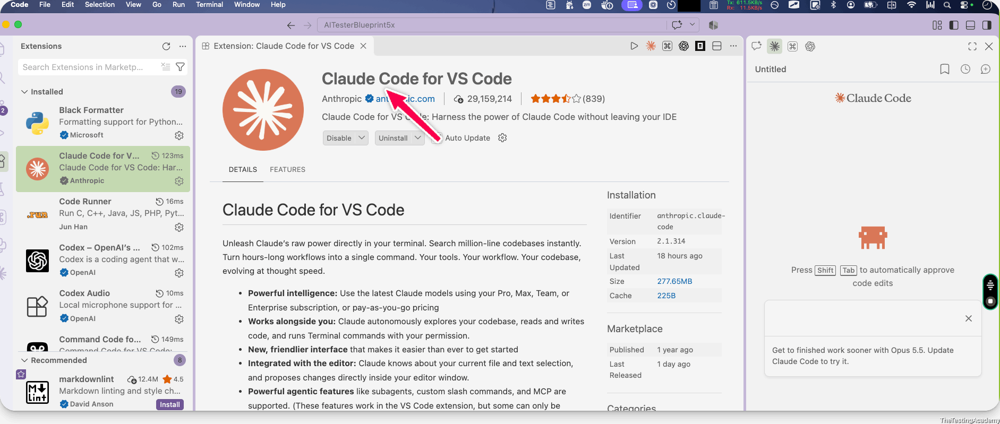
--------------------------------------------------------
# What is a token?
- The model reads pieces of words, not letters and not whole words.
- **Token ->** A small piece of text: a whole word, part of a word, a space plus a word, punctuation, or part of an emoji.
- Token != Word


**Tokenizer**

The **tool that cuts text into tokens** and gives each one a number.

[platform.openai.com/tokenizer](https://platform.openai.com/tokenizer) 

**Token ID**

The number for a token. The model only ever sees these numbers.
 

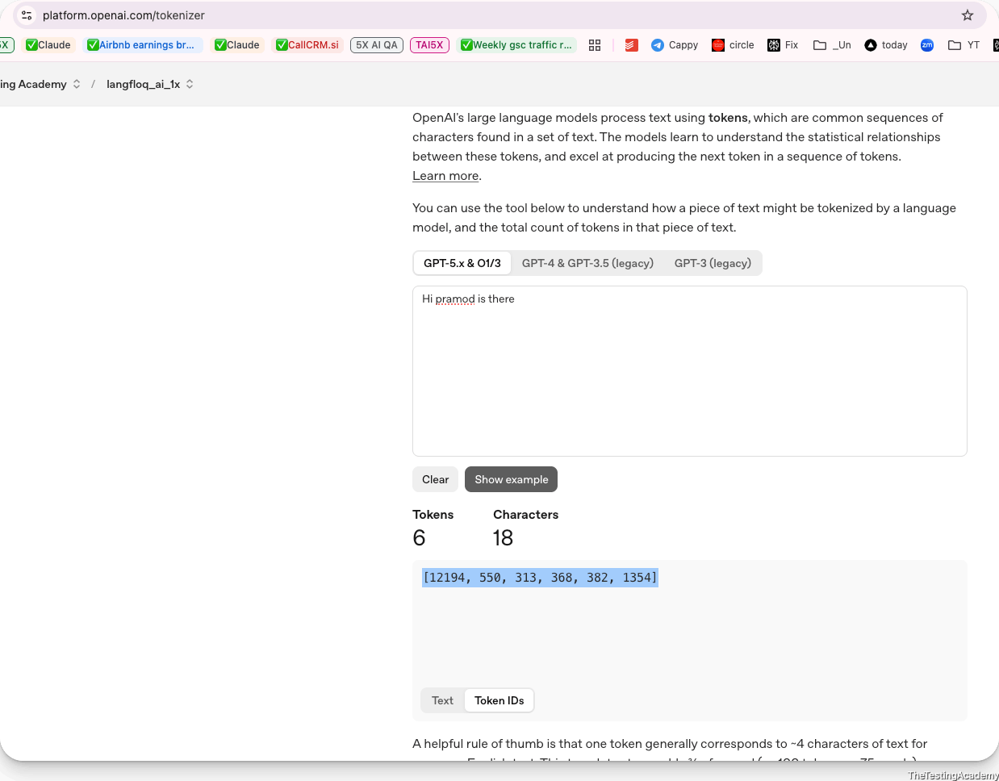

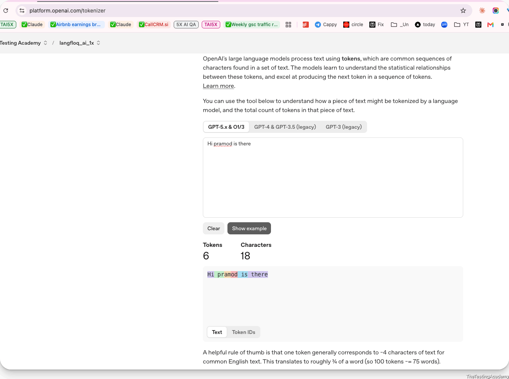

Common words are usually one token. Rare words, names and IDs are cut into several pieces. A rule of thumb for English: **1 token ≈ 4 characters ≈ ¾ of a word**, so 100 tokens is about 75 words.

[github.com/PramodDutta/AITesterBlueprint5x](https://github.com/PramodDutta/AITesterBlueprint5x) 

**Download and open in the Chrome** 

[github.com/PramodDutta/AITesterBlueprint5x/blob/main/Chapter_01_LLM_Basics/LLM_Fundamentals.html](https://github.com/PramodDutta/AITesterBlueprint5x/blob/main/Chapter_01_LLM_Basics/LLM_Fundamentals.html) 

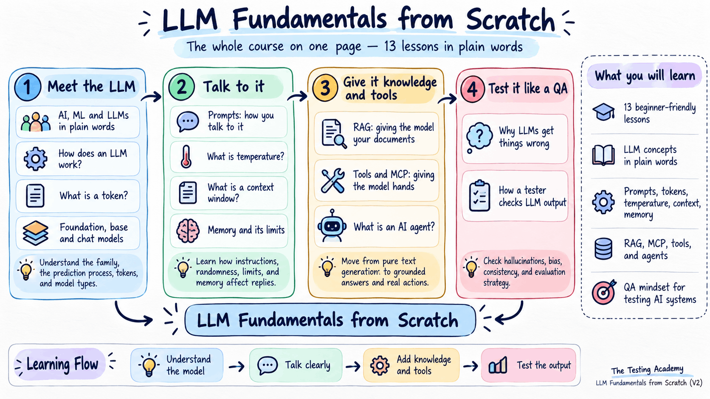

gemma3:1b, -> llama -> deepseek1.5b

[www.cashify.in/buy-refurbished-laptops/renewed-macbook-air-2020-a2337-apple-m1-chip-133-inch/179199?productId=85447](https://www.cashify.in/buy-refurbished-laptops/renewed-macbook-air-2020-a2337-apple-m1-chip-133-inch/179199?productId=85447) 

# Foundation, Base and Chat models

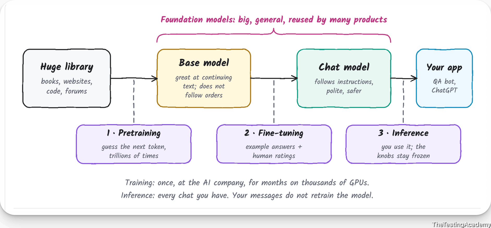

[proceedings.neurips.cc/paper_files/paper/2017/file/3f5ee243547dee91fbd053c1c4a845aa-Paper.pdf](https://proceedings.neurips.cc/paper_files/paper/2017/file/3f5ee243547dee91fbd053c1c4a845aa-Paper.pdf) 


1 book, 1page , 1para -> Parameters -> convert them in weights store them

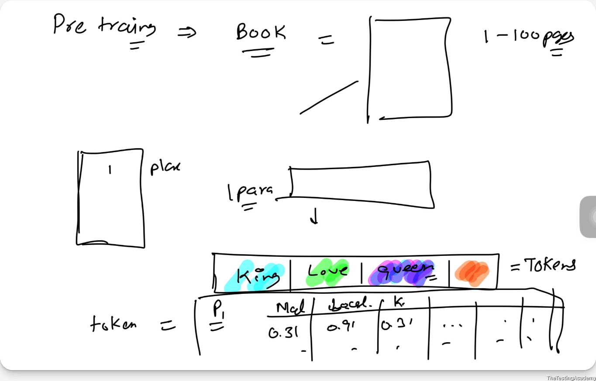

## What is Token?

In AI and Large Language Models (LLMs), a token is the smallest unit of text that a model reads, processes, and generates.

Think of a token as a "piece of text" that can be:

A whole word
Part of a word
A punctuation mark
A number
A special character
Simple Example

Sentence
I love AI.

Possible tokens:
```
["I", " love", " AI", "."]
```
Total: 4 tokens

Why Tokens Matter

AI models do not understand text directly.

Before processing, the text is converted into tokens.

```
User Input
     ↓
Tokenization
     ↓
Tokens
     ↓
LLM Processing
     ↓
Response Tokens

```

The model predicts the next token one by one until the response is complete.

Example 1: Word Splitting

Text:
```
Automation
```

May be tokenized as:
```
["Auto", "mation"]
```
Here, one word becomes 2 tokens.

Example 2: Sentence

Text:
```
API automation testing is fun.
```

Possible tokens:
```
["API", " automation", " testing", " is", " fun", "."]
```
Total: 6 tokens

Special Characters
```
user@test.com
```
Possible tokens:
```
["user", "@", "test", ".", "com"]
```

Token vs Word
| Text               | Words        | Approx. Tokens     |
| ------------------ | ------------ | ------------------ |
| Hello              | 1            | 1                  |
| Automation         | 1            | 2-3                |
| I love API testing | 4            | 4-6                |
| 1000 lines of code | ~2500 words  | ~3000-4000 tokens  |

## Real-Time Example (Playwright API Automation)
Prompt:  
Create a Playwright TypeScript test for POST /alm/alarms/create

Possible tokens:  
["Create", " a", " Playwright", " TypeScript",
 " test", " for", " POST", " /alm",
 "/", "alarms", "/", "create"]  

 The LLM processes these tokens and predicts the next tokens to generate the test script.

 ### ELI5 (Explain Like I'm 5)
 Imagine you give a sentence to AI:
I like mangoes.

The AI cuts it into small LEGO blocks:
[I] [like] [mango] [es] [.]

These LEGO blocks are called tokens.

The AI reads the blocks one by one and uses them to figure out what should come next.

So:

Token = the basic building block of text that an AI model reads and writes.

Just like a computer stores data in bytes, an AI language model processes language in tokens.

## What is Paramter?

In the AI/LLM perspective, a parameter is a value inside the model that the AI learns during training and uses to make predictions.

Simple Definition

**Parameters are the learned "knowledge" of an AI model.**

They store patterns, relationships, and information learned from massive amounts of data.

**Human Brain Analogy**

Think of an AI model like a human brain.

>. Training Data = Books, websites, conversations the AI learns from  
>. Parameters = Connections between neurons that store what was learned  
>. Inference = Using that learned knowledge to answer questions

Just as your brain remembers that:
2 + 2 = 4  --> an AI stores this knowledge in its parameters.

**Example**

Suppose the model sees millions of examples like:  
Sky → Blue  
Grass → Green  
Fire → Hot  

During training, parameters are adjusted until the model learns these relationships.

Later:  
Input:  The sky is...
The parameters help the AI predict:  blue  

**Parameters in Neural Networks**  
A neural network consists of many mathematical connections.  

Each connection has a weight.  

Example:  
Input → Weight → Output  

That weight is a parameter.  

Simple equation:  
Output = Input × Weight  
If:  
Input = 10  
Weight = 0.8  

Then : Output = 8  
During training, the AI continuously adjusts these weights (parameters) to reduce errors.

**What Does "7 Billion Parameters" Mean?**
When people say: Llama 2 7B OR  Gemma 7B they means 7 Billion Parameters  
Similarly  

| Model | Approximate Parameters |
|---|---|
| GPT-2 | 1.5 Billion |
| Llama 2 7B | 7 Billion |
| Llama 2 70B | 70 Billion |
| GPT-class modern models | Hundreds of billions+ (not always disclosed) |
|||


More parameters generally mean:  

 ✅ Better understanding  
 ✅ Better reasoning  
 ✅ Better language quality  

But:  

 ❌ More memory usage  
 ❌ Slower inference  
 ❌ Higher cost  


## Parameters vs Tokens

These two terms are often confused.


| Term | Meaning |
|---|---|
|Token|Piece of text the model reads/writes|
|Parameter|Learned value inside the model|
|||

Example:  

Input:  
Explain API Testing  

Tokens:  
["Explain", "API", "Testing"]  

The model uses its parameters to understand those tokens and generate a response.

## Parameters vs Hyperparameters  
Another common confusion:  
|Parameter|Hyperparameter|
|---|---|
|Learned automatically during training|Set by engineers before training|
|Weights in the network|Learning rate, batch size, epochs|
|Millions/Billions of values|Usually a few settings|
|||

Example:
Learning Rate = 0.001  
Batch Size = 32  

These are hyperparameters, not parameters.  

## Real Example (API Automation Context)
Suppose you ask:  
Create a Playwright TypeScript test for POST /alm/alarms/create  
The model:
> 1 Converts your prompt into tokens.  
> 2 Uses billions of parameters learned from code examples.   
> 3 Predicts the next token.   
> 4 Generates a Playwright script.   

Your text = Tokens  
Model's learned coding knowledge = Parameters  

**ELI5 (Explain Like I'm 5)**  

Imagine AI is a student.  

> . Tokens are the words the student reads.  
> . Parameters are everything the student has learned and remembers.  

So:
```
Tokens = Input words
Parameters = Learned knowledge
Response = Result of using that knowledge

```
In one line:  
A token is the text AI processes, while a parameter is the learned value inside the AI model that stores knowledge and helps it make predictions.

## What is Knob?
In AI, the term "knob" is an informal way of referring to a setting, control, or tunable parameter that changes the behavior of a model or AI system.  

Think of it like the knobs on a music system:  

>. Volume knob → controls loudness  
>. Bass knob → controls bass level  
>. Treble knob → controls high frequencies  

Similarly, AI systems have "knobs" that control how they respond.  

**Common AI Knobs**
1. Temperature  

Temperature controls randomness in the model's output.  

Low Temperature (0.0 - 0.3)  

>. Predictable  
>. Consistent  
>. Deterministic  

Example:  
Prompt:  What is 2 + 2?  
Output: 4  
almost every time.  

High Temperature (0.8 - 1.5)

>. More creative
>. More varied
>. Less predictable
Prompt: 
Write a slogan for API automation.  

Possible outputs:  
Automate Today, Innovate Tomorrow!    
Testing at the Speed of Thought!    
Here, Temperature is a knob.  

Max Tokens:
Controls how much text the model can generate.  
Example:  
Max Tokens = 20  
Output:  
API testing validates endpoints and verifies responses.  
Short answer.  
Max Tokens = 500  
Output:  
Detailed explanation with examples.  

**Max Tokens is another knob.**   

## What is fine tuning

**Fine-tuning** is the process of taking a pre-trained AI model and training it further on a specific dataset so it becomes better at a particular task, domain, or style.  

Simple Definition
**Fine-tuning = Teaching an already smart AI a specialized skill.**

Instead of training an AI from scratch, we start with an existing model that already knows language, coding, reasoning, etc., and then provide additional focused training.  

### Human Learning Analogy

Think of a person who has completed engineering.  

### Pre-training

The person learns:  

>. Mathematics  
>. Physics  
>. Programming  
>. Communication  

This is like a foundation model (GPT, Llama, Gemini).  

**Pretraining.** The model reads trillions of tokens of books, websites and code. It practises one thing: hide the next token, guess it, check the real one, adjust its knobs a tiny bit. This repeats billions of times and takes months on thousands of computer chips (GPUs).  

The result is a **base model**. It knows language and a lot about the world, but it only continues text. Ask it a question and it may continue with more questions, because that is what it saw in documents.  

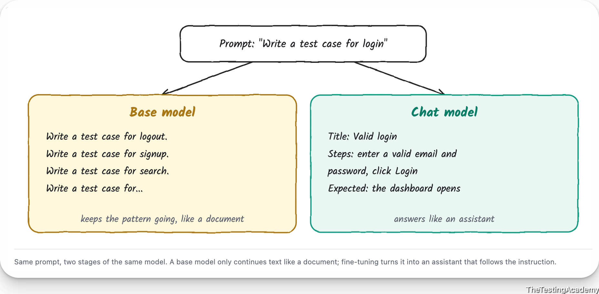


### Fine-tuning   

**Fine-tuning** then turns it into an assistant. First, thousands of example conversations show it how a good answer looks (this is called instruction tuning). Then people rate pairs of answers, and the model learns to prefer the better ones (this is called **RLHF**: reinforcement learning from human feedback). The result is a **chat model**, like the ones inside ChatGPT or Claude.


The same person takes a specialized course in:  

>. API Testing  
>. Playwright Automation  
>. Cybersecurity  

Now they're an expert in that area.  

That's exactly what fine-tuning does for AI.  

### Fine-Tuning vs Prompt Engineering  
People often confuse these.  

### Prompt Engineering  
You instruct the model:  
Act as an API Test Automation Engineer.  
Generate Playwright TypeScript code.  

No model training occurs.  

### Fine-Tuning  
The model is actually retrained on API automation examples.  

Knowledge becomes part of the model's behavior.  


**Chat GPT:** Fine tuned base model with access to tools  

2 + 2 = 4  
an AI stores this knowledge in its parameters.  

**Example**

Suppose the model sees millions of examples like:


# Small Language Models (SLMs) vs Large Language Models (LLMs)
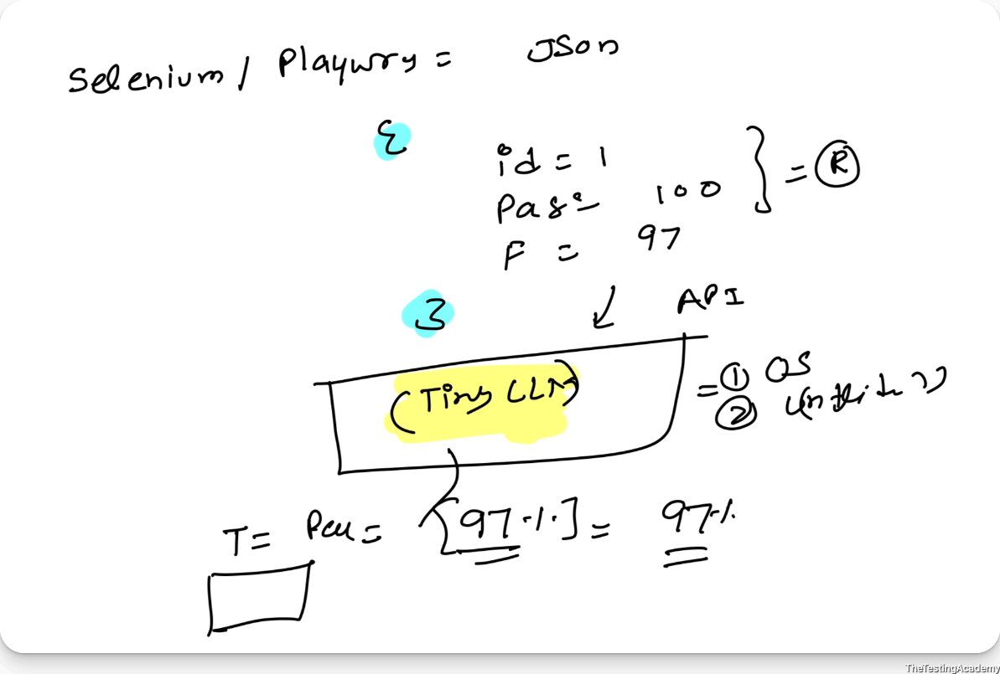

[huggingface.co/arnir0/Tiny-LLM](https://huggingface.co/arnir0/Tiny-LLM) 

Tiny-LLM:  
A Tiny LLM model with just 10 Million parameters, this is probably one of the small LLM arounds, and it is functional.  

Pretraining:    
Tiny-LLM was trained on 32B tokens of the Fineweb dataset, with a context length of 1024 tokens.  


Think of it as the difference between a compact car and a truck:  

>. **SLM (Small Language Model)** = Faster, cheaper, lightweight.  
>. **LLM (Large Language Model)** = More knowledgeable, powerful, but requires more resources.  


| Aspect | Small Language Model (SLM) | Large Language Model (LLM) |
|----------|--------------------------|----------------------------|
| Parameters | Millions to a few billion | Tens to hundreds of billions+ |
| Size | Small enough for edge devices | Requires powerful servers/GPUs |
| Speed | Very fast | Slower |
| Cost | Low inference cost | Higher inference cost |
| Hardware | Laptop, mobile, IoT devices | Cloud GPUs and data centers |
| Knowledge | Limited | Broad and deep |
| Reasoning | Good for simple tasks | Better for complex reasoning |
| Context Understanding | Smaller context | Larger context windows |
| Use Cases | Classification, chatbots, summarization, command execution | Coding, research, analysis, content creation, advanced reasoning |

### Real-World Examples

## Small Language Models (SLMs)

### Examples

1. Microsoft Phi-3
2. Microsoft Phi-4
3. Google Gemma 2B
4. TinyLlama
5. DistilBERT

### Typical Size

```text
Phi-3 Mini ≈ 3.8 Billion Parameters
```

### Can Often Run On

- Laptops
- Mobile devices
- Edge gateways
- IoT devices

---

## Large Language Models (LLMs)

### Examples

1. GPT-5 family
2. GPT-4 series
3. Claude Opus
4. Gemini Ultra
5. Llama 3 70B+

### Typical Size

```text
70B+
100B+
500B+
```

### Usually Run On

- Azure AI
- AWS Bedrock
- Google Vertex AI
- High-end GPU clusters

---

## Example

### Question

> Generate a complete Playwright API automation framework with reporting, CI/CD, and test data management.

### SLM Response

- Creates basic framework
- Simpler architecture
- May miss advanced patterns

### LLM Response

- Multi-layer architecture
- Environment configuration
- Reporting (Allure, HTML)
- CI/CD pipelines
- API utilities
- Data management
- Better design decisions

---

## Resource Consumption

### SLM

```text
CPU: Low
RAM: 4-16 GB
Cost: $
```

### LLM

```text
CPU/GPU: High
RAM: 80+ GB GPU Memory
Cost: $$$$
```

---

### When to Use an SLM

✅ Offline applications

✅ Mobile apps

✅ Edge/IoT deployments

✅ Simple customer support

✅ Text classification

✅ Intent detection

### Example
```
"Reset password"
→ Detect intent
→ Route request
```
An SLM is often sufficient.  

### When to Use an LLM

✅ Software development

✅ API test generation

✅ Complex document analysis

✅ Research assistants

✅ Multi-step reasoning

✅ Enterprise copilots

```
Analyze 200-page PRD,
identify gaps,
generate test cases,
create automation scripts.
```
An LLM is much better suited.

### QA Automation Analogy
For your API automation work:

SLM  
```
Input:
Generate a POST request test.

Output:
Basic test script.
```

LLM  
```
Input:
Generate Playwright API framework for LFOD APIs.

Output:
- Framework structure
- Auth handling
- Environment setup
- Data models
- Reporting
- CI/CD integration
- Error handling
- Test cases
```

One-Line Summary

**A Small Language Model (SLM) is optimized for speed, cost, and local deployment, while a Large Language Model (LLM) is optimized for knowledge, reasoning, and handling complex tasks.**


### **PDFTextExtractorAI** agent using tiny OCR and LLM 
TinyOCR 0.1.0
English-first, offline CPU OCR with 3.10 MB of ONNX model files. This is a compressed pretrained PaddleOCR PP-OCRv6 model pair, not a newly trained TinyOCR student. The detector is unchanged; the recognizer stores selected weights as per-channel int8 values with constant decoding to float32. Computation remains float32. No training or calibration was performed. The dataset tag describes evaluation, not TinyOCR training.

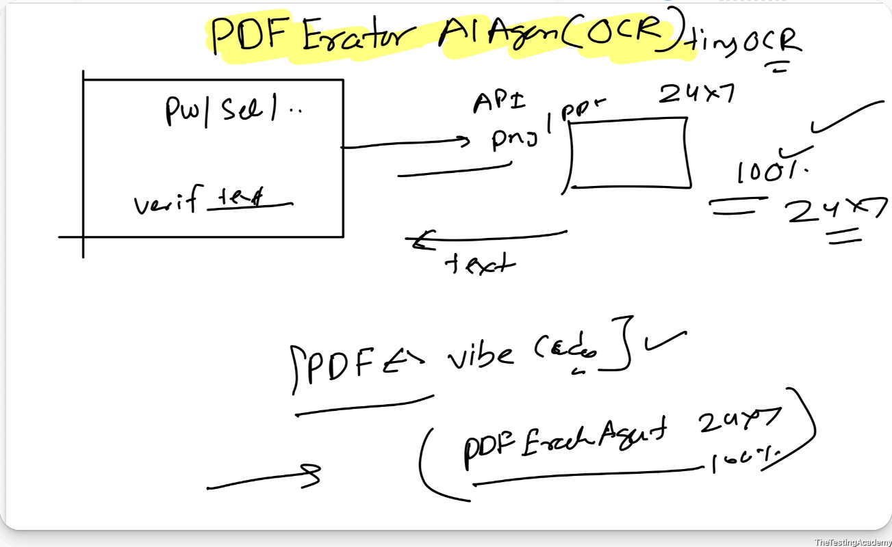

Building this also, After the BLAST Framework.

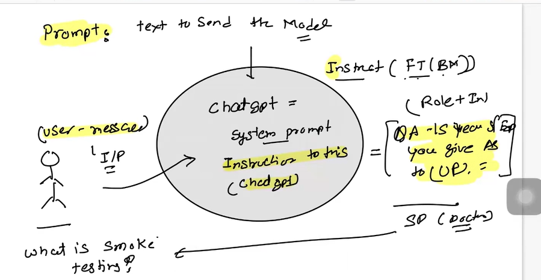