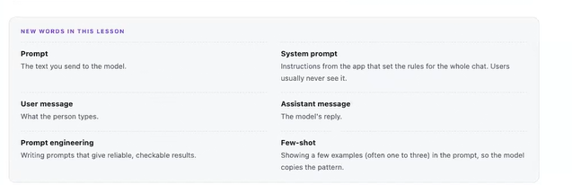
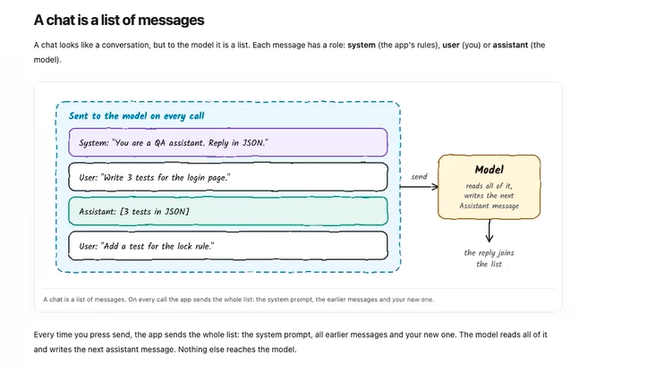

## What is Prmpting in AI?

**Prompting** is the process of giving instructions, questions, context, or examples to an AI model so that it generates the desired output.

### Simple Definition
**A prompt is the input you give to an AI, and prompting is the art of writing that input effectively.**  

The quality of the AI's response depends heavily on the quality of the prompt.

Ex:  
Imagine you're talking to a junior engineer. 

Write a test case.  

Output may be:  
You may get something generic.  

Clear request:  
Write a Playwright TypeScript API test case for POST /alm/alarms/create.  
Validate response code 201 and verify alarm creation.  

You'll get a much more useful result. AI works the same way.



## Difference Between a Base Model and a Fine-Tuned Model
Think of it like **a new graduate vs an employee trained for a specific job.**  

|Aspect|Base Model|Fine-Tuned Model|
|----|----|----|
|Definition|A general-purpose AI model trained on massive amounts of data|A base model further trained on specific data or tasks|
|Knowledge|Broad, general knowledge|Specialized knowledge for a domain|
|Flexibility|Can perform many tasks reasonably well|Excels at specific tasks|
|Accuracy|Good overall|Higher accuracy for targeted use cases|
|Training Data|Internet-scale datasets, books, code, articles, etc.|Domain-specific examples, instructions, or business data|
|Cost to Build|Very high (millions of dollars)|Much cheaper than training from scratch|
|Examples|GPT-5, Llama, Mistral, Gemini base models|Medical chatbot, legal assistant, customer support bot|
||||


### Real-World Example  
Base Model  

Ask:  

"Create an API test case for a POST endpoint."  
Response:  

>. Understands API testing concepts  
>. Generates generic test cases  
>. Works for many industries  

Fine-Tuned Model  

If the model is fine-tuned using:  
>. Playwright API framework examples  
>. PRS APIs  
>. LFOD profile requests  
>. Your organization's payload structures  

Ask the same question:  

"Create an API test case for LFOD POST endpoint."  

Response:  

>. Uses your endpoint conventions  
>. Knows required headers  
>. Understands specific error codes  
>. Produces organization-specific test cases   

## User prompt vs System prompt

A **User prompt** is text/messsage that user sent to a model  

A **System prompt** is a instructions to the Model(ChatGPT) : it is a instruction to fine tuned base model




====================================================================================


# Prompt Engineering

## Key Points from the Sketch

### 1. Prompt → Prompt Engineering

A **prompt** is simply an instruction, query, or question given to an AI model.

**Prompt Engineering** is the process of designing, refining, and optimizing prompts to get better results from the AI.

**Example:**

**Basic Prompt**

```text
Create API test cases.
```

**Engineered Prompt**

```text
Act as a Senior QA Architect.

Generate Playwright API test cases for LFOD Profile Creation API.

Include positive, negative, authorization, compatibility, and error-handling scenarios.

Output in tabular format.
```

---

### 2. Skill to Learn

The sketch suggests:

> "Prompt Engineering is a skill that helps obtain maximum and accurate results from an LLM."

#### Meaning

Prompt engineering helps users:

- Improve response quality
- Increase accuracy
- Reduce ambiguity
- Obtain consistent answers
- Generate structured outputs

The better the prompt, the better the output.

---

### 3. Desired Output (O/P)

The objective is not merely getting a response.

The objective is obtaining a response that is:

- Accurate
- Relevant
- Complete
- Structured
- Actionable

#### Example

**Weak Prompt**

```text
Explain API testing.
```

**Output**

Generic explanation.

**Engineered Prompt**

```text
Explain API testing from a QA Automation perspective.

Include:
- REST concepts
- HTTP methods
- Status codes
- Validation checks
- Playwright examples

Use beginner-friendly language.
```

**Output**

Detailed, structured, and targeted explanation.

---

### 4. Prompt Engineering Frameworks

There are many frameworks used by prompt engineers and AI practitioners.

### Popular Frameworks

| Framework | Meaning | Purpose |
|------------|----------|----------|
| RICCE | Role, Instruction, Context, Constraints, Examples | Structured prompting |
| RACE | Role, Action, Context, Expectation | Better task definition |
| RISEN | Role, Instructions, Steps, End Goal, Narrowing | Detailed task execution |
| TAG | Task, Action, Goal | Simple prompt structure |
| COAST | Context, Objective, Actions, Style, Tone | Content generation |
| CoT | Chain of Thought | Step-by-step reasoning |
| ToT | Tree of Thoughts | Exploring multiple reasoning paths |
| ReAct | Reason + Act | Advanced reasoning agents |
| APE | Automatic Prompt Engineering | AI-generated prompts |

---

### 5. Example Framework: RICCE

#### RICCE Structure

```text
R = Role
I = Instruction
C = Context
C = Constraints
E = Examples
```

#### Example

```text
Role:
Act as a Senior QA Architect.

Instruction:
Generate API test cases.

Context:
LFOD Profile Creation API.

Constraints:
Use Playwright.
Include positive and negative scenarios.

Example:
Provide output in
Test ID | Scenario | Expected Result format.
```

This prompt generally produces much better results than:

```text
Generate API test cases.
```

---

## QA Automation Example

### Weak Prompt

```text
Create API test cases.
```

### Typical Output

- Generic test cases
- Missing business context
- Limited coverage
- Inconsistent results

---

### Engineered Prompt

```text
Act as a Senior QA Architect.

Generate Playwright API test cases for LFOD Profile Creation API.

Include:
- Positive scenarios
- Negative scenarios
- Authorization validation
- API version compatibility
- Error response validation
- Expected HTTP status codes

Output in the format:

Test ID | Scenario | Steps | Expected Result
```

### Typical Output

- Detailed
- Structured
- Reusable
- Higher quality
- Better coverage
- Easier automation implementation

---

## Prompt Engineering Workflow

```text
Prompt
   ↓
Prompt Engineering
   ↓
Apply Frameworks (RICCE, RACE, RISEN, CoT, ReAct)
   ↓
Provide Context & Constraints
   ↓
LLM
   ↓
Desired Output
   ↓
Accurate, Relevant, Structured Results
```

---

## Benefits of Prompt Engineering

### For Developers

- Better code generation
- Faster debugging
- Improved architecture recommendations

### For QA Engineers

- Better test cases
- Automation script generation
- API validation scenarios
- Test data generation
- Requirement analysis

### For Business Users

- Better reports
- Better document summaries
- Better decision support

---

## Simple Definition

> **Prompt Engineering is the practice of designing and refining prompts using proven frameworks, context, constraints, and examples to obtain accurate, consistent, structured, and desired results from Large Language Models (LLMs).**